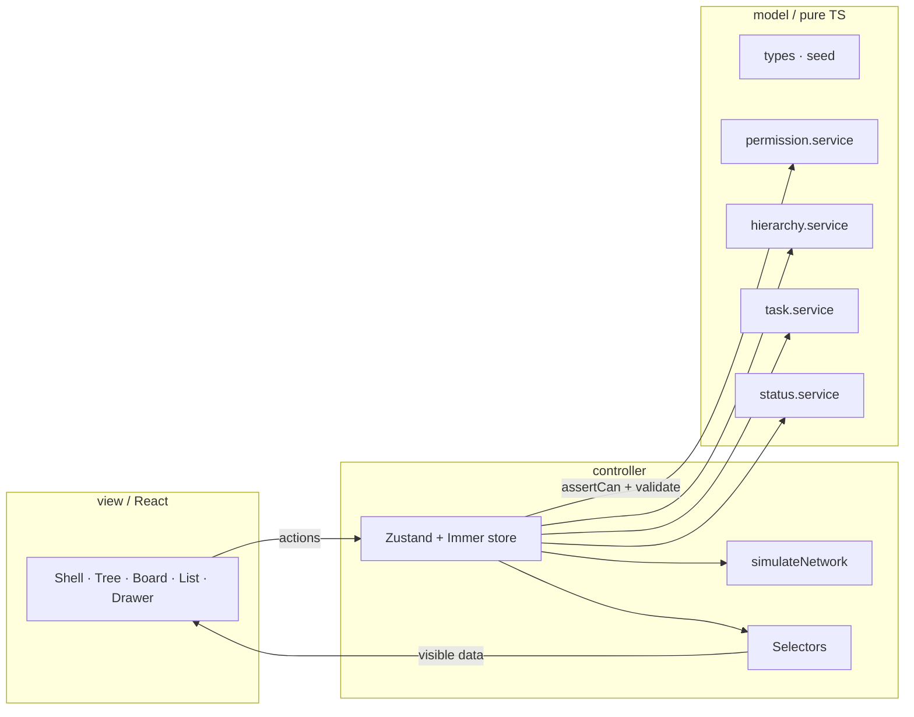

# Flowboard

Mini project-management app (ClickUp / Asana / Linear style) for a frontend take-home. Hierarchy tree, kanban board with drag-and-drop, sortable list view, task drawer, client-side permissions, optimistic mutations with simulated network failures, and dark mode.

## Getting started

```bash
npm install
npm run dev
```

| Command | Description |
| --- | --- |
| `npm run dev` | Vite dev server |
| `npm run build` | Typecheck + production build |
| `npm run typecheck` | TypeScript project references check |
| `npm run test` | Vitest unit/component tests |
| `npm run test:e2e` | Playwright permission-flow E2E |
| `npm run lint` | ESLint |

## Demo video

<!-- Paste your Loom / YouTube URL before submission. -->
**Demo:** _add link here (3–5 min: tree, kanban DnD, card/drawer, list sort, Alice→Bob, Dev menu failure + rollback)._

## Architecture

Strict MVC under `src/`:



**Mutation pipeline:** permission check → service validation → simulated latency/failure → apply → toast / activity.

- `model/` — never imports React, controller, or view. Services return `Result<T>` and never mutate inputs.
- `controller/` — only layer that mutates state (`store.ts`, `selectors.ts`).
- `view/` — reads via selectors/hooks; calls store actions; no business rules.

## Data model

Normalised `AppState` keyed by id (`src/model/types.ts`, seed in `src/model/seed.ts`):

| Entity | Key fields |
| --- | --- |
| **ContainerNode** | `id`, `kind` (`workspace` \| `space` \| `folder` \| `list`), `name`, `parentId`, `position`, `archivedAt`, `isPrivate` |
| **Status** | `id`, `listId`, `name`, `category` (`todo` \| `active` \| `done`), `color` (hex), `position` |
| **Task** | `id`, `listId`, `title`, `description`, `statusId`, `priority`, `assigneeIds`, `dueDate` (`YYYY-MM-DD` \| null), `position`, `parentTaskId`, `archivedAt`, `activity[]` |
| **User** | `id`, `name`, `email`, `role` (`admin` \| `member`), `color`, `avatarUrl` |
| **Grant** | `id`, `userId`, `nodeId`, `effect` (`allow` \| `view` \| `deny`) |

Hierarchy: workspace → space → folder → list → tasks. Ordering uses fractional `position` (`between` / `after` / `before`); siblings are never renumbered.

### Deviations from the brief

| Brief | This repo | Why |
| --- | --- | --- |
| Node `type` | `kind` | Matches common tree APIs; avoids TS `type` keyword clash |
| Task `primaryListId` | `listId` | One list per task in this scope |
| Grant `resourceId` / `mode` | `nodeId` / `effect` | Clearer names; extra `view` effect for read-only |
| Status category `in_progress` | `active` | Shorter token; UI label remains “In Progress” |
| `dueDate` ISO datetime | date string `YYYY-MM-DD` | Calendar-day semantics; avoids TZ display bugs |
| — | Grant `view` + task `activity[]` | Read-only demo + drawer feed (Figma) |

## Permissions (client)

Enforced in **model + controller**, never only in the UI:

1. **Admin** bypasses all checks.
2. **Members:** nearest grant on the node or ancestors wins (`allow` = view+edit, `view` = read-only, `deny` = hidden).
3. If no grant: any `isPrivate` ancestor hides the node; otherwise visible/editable.
4. Selectors return only visible nodes/tasks. Every store mutation calls `assertCan` first → `FORBIDDEN` on failure.
5. User switch resets selection if invisible, closes the drawer, and toasts.

**Seed demo:** Alice (admin) sees everything. Bob is denied Leadership / OKRs; Carol has a `view` grant for read-only.

**Extending permissions**

- Add effects (e.g. `comment`) on `GrantEffect` and branch in `canEdit` / `canView`.
- Scope grants to task ids by extending `assertCan` targets (today container-centric).
- Persist grants via an API later; keep the same pure `permission.service` and call it from the store after fetch.
- Admin UI already has a Grants dialog; wire create/update/delete grant actions the same way as other mutations.

## Persistence & archive

- **No domain persistence.** Reloading resets to seed. Only UI preference `flowboard.theme` (`light` \| `dark` \| `system`) is stored in `localStorage`.
- **Archive = soft delete.** Containers and tasks set `archivedAt`; archive cascades to descendants; restore clears the flag. Tasks can be hard-deleted after confirm. Chosen over hard-delete-only so the Alice/Bob demo and “Undo” toast stay honest without a backend.

## Inline `style=` exceptions

Tailwind-only styling; no CSS modules / styled-components. Allowed exceptions:

| Location | Reason |
| --- | --- |
| `SortableTaskCard.tsx`, `SortableTreeRow.tsx` | dnd-kit `transform` / `transition` (`// DND-STYLE-EXCEPTION`) |
| `ListView.tsx` virtual rows | react-window absolute geometry via row `style` (`// VIRTUALIZE-STYLE-EXCEPTION`) |

## Extra libraries (justified)

| Library | Why |
| --- | --- |
| `react-window` | Virtualize long list views (page windows can still grow via Load more) |
| `cmdk` | Accessible command palette patterns used by shadcn-style menus |
| `react-day-picker` | Calendar for due dates (shadcn date picker) |

Stack also includes dnd-kit, Zustand + Immer, sonner, date-fns, lucide-react — all called out in the brief / project rules.

## Stretch goals attempted

- Dark mode + theme preference (brief lists dark mode as out of scope; implemented and kept non-breaking).
- Keyboard shortcuts cheatsheet (Figma 24–25).
- Tree sibling drag-reorder; list offset pagination (page size 10 + Load more).
- Admin grants dialog; Dev menu network failure / latency simulation.
- Brand favicons / sidebar logo.

**Not in UI (service-only):** add / rename / reorder / delete **statuses**. `status.service` is implemented and tested; list creation seeds TODO / In Progress / Done. No status editor in the shell.

## Trade-offs & week-2 plans

| Trade-off | Notes / week-2 fix |
| --- | --- |
| Optimistic **rollback restores a full domain snapshot** | Two rapid drags can race: if the first fails after the second succeeds, rollback can overwrite the second change. **Week-2:** snapshot only the affected task (or use per-mutation undo tokens). |
| Production bundle ~661 kB | Acceptable for a take-home; optional route/view code-splitting would clear the Vite warning. |
| Status colors mapped hex → Tailwind classes | Keeps Tailwind-only styling; unknown hex falls back to category tokens. |
| Simulated network only | Real API + persistence would replace `simulateNetwork` and seed. |

## AI usage

See [`AI_USAGE.md`](./AI_USAGE.md) for the Cursor / AI log (what helped, what was corrected).

## Plan & checklist

- Checklist: [`plan/CHECKLIST.md`](plan/CHECKLIST.md)
- Progress: [`plan/PROGRESS.md`](plan/PROGRESS.md)
- Tested per issue: [`plan/TESTED.md`](plan/TESTED.md)
- Rules: [`.cursor/rules/flowboard.mdc`](.cursor/rules/flowboard.mdc)
