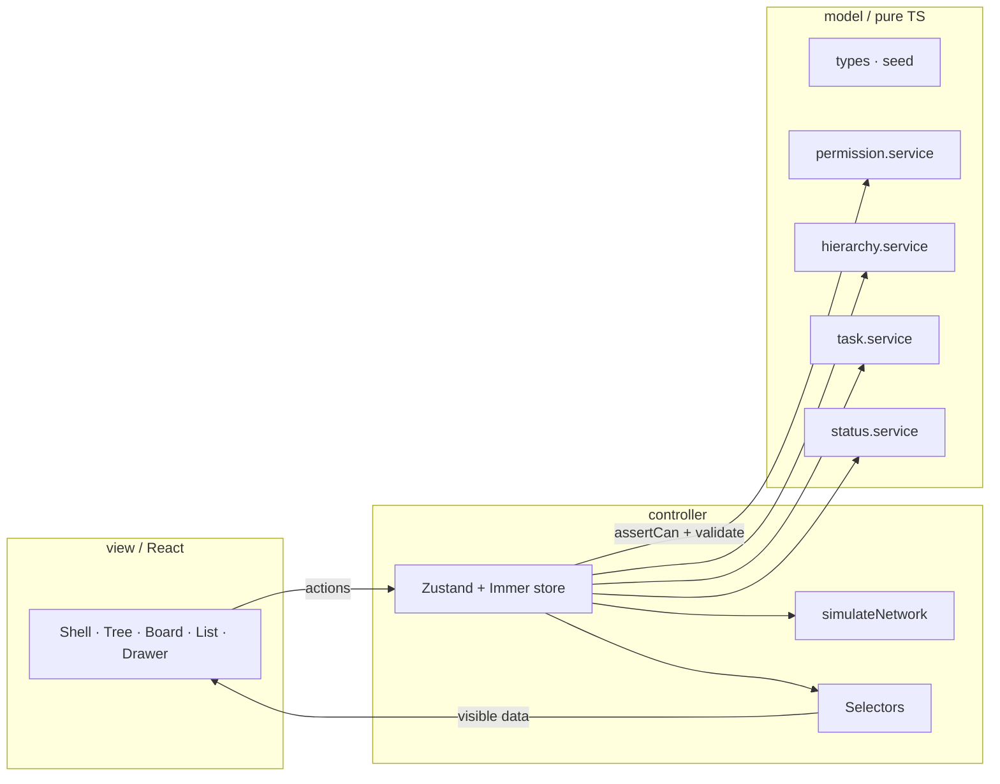

# Flowboard

A mini project-management app (ClickUp / Asana / Linear style) built as a frontend take-home.

**Includes:** hierarchy sidebar, kanban board with drag-and-drop, sortable list view, task drawer, client-side permissions with user switching, optimistic mutations with simulated network failures, and dark mode.

---

## Run locally

```bash
npm install
npm run dev
```

| Command | Description |
| --- | --- |
| `npm run dev` | Start Vite |
| `npm run build` | Typecheck + production build |
| `npm run typecheck` | TypeScript check |
| `npm run test` | Vitest (unit + component) |
| `npm run test:e2e` | Playwright permission-flow E2E |
| `npm run lint` | ESLint |

---

## Demo video

<!-- Paste Loom / YouTube URL before submission. -->
**Link:** _add here_

Suggested walkthrough (3–5 min): tree → kanban DnD → card/drawer → list sort → Alice → Bob permissions → Dev menu failure + rollback.

---

## Architecture

Strict MVC under `src/`:



**Mutation pipeline:** permission check → service validation → simulated network (Dev menu → Fail next) → apply → toast / activity.

| Layer | Responsibility |
| --- | --- |
| `model/` | Pure TypeScript. No React. Services return `Result<T>` and never mutate inputs. |
| `controller/` | Only layer that mutates state (`store.ts`, `selectors.ts`). |
| `view/` | React UI. Reads via selectors; calls store actions. No business rules. |

---

## Data model

Normalised `AppState` keyed by id (`src/model/types.ts`). Seed data: `src/model/seed.ts`.

| Entity | Key fields |
| --- | --- |
| **ContainerNode** | `id`, `kind` (`workspace` \| `space` \| `folder` \| `list`), `name`, `parentId`, `position`, `archivedAt`, `isPrivate` |
| **Status** | `id`, `listId`, `name`, `category` (`todo` \| `active` \| `done`), `color` (hex), `position` |
| **Task** | `id`, `listId`, `title`, `description`, `statusId`, `priority`, `assigneeIds`, `dueDate` (`YYYY-MM-DD` \| null), `position`, `parentTaskId`, `archivedAt`, `activity[]` |
| **User** | `id`, `name`, `email`, `role` (`admin` \| `member`), `color`, `avatarUrl` |
| **Grant** | `id`, `userId`, `nodeId`, `effect` (`allow` \| `view` \| `deny`) |

**Hierarchy:** workspace → space → folder → list → tasks.

**Ordering:** fractional `position` via `between` / `after` / `before`. Siblings are never renumbered.

### Naming vs the brief

| Brief | This repo | Reason |
| --- | --- | --- |
| Node `type` | `kind` | Clearer in tree APIs; avoids clashing with TS `type` |
| Task `primaryListId` | `listId` | One list per task in this scope |
| Grant `resourceId` / `mode` | `nodeId` / `effect` | Clearer names; `view` added for read-only |
| Status category `in_progress` | `active` | Shorter token; UI label is still “In Progress” |
| `dueDate` ISO datetime | `YYYY-MM-DD` | Calendar-day semantics; avoids timezone display bugs |

Also included beyond the minimal brief: Grant `view`, task `activity[]` for the drawer feed.

---

## Permissions

Enforced in **model + controller**, never only in the UI.

1. **Admin** bypasses all checks.
2. **Members:** nearest grant on the node or ancestors wins — `allow` (view + edit), `view` (read-only), `deny` (hidden).
3. If no grant applies: any `isPrivate` ancestor hides the node; otherwise the node is visible.
4. Selectors return only what the current user can see. Every mutation calls `assertCan` first and returns `FORBIDDEN` on failure.
5. Switching users resets selection if the target is no longer visible, closes the drawer, and shows a toast.

**Seed demo**

- **Alice** (admin) — full access
- **Bob** — denied Leadership / OKRs
- **Carol** — `view` grant (read-only where granted)

### Extending permissions

- Add effects (e.g. `comment`) on `GrantEffect` and branch in `canView` / `canEdit`.
- Scope grants to tasks by extending `assertCan` targets (today they are container-centric).
- Keep `permission.service` pure; wire persistence later through the same store pipeline.
- The admin Grants dialog is already in the UI; create/update/delete grants would follow the same mutation pattern as other actions.

---

## Persistence and archive

| Decision | Detail |
| --- | --- |
| **No domain persistence** | Reload resets to seed. Only `flowboard.theme` (`light` \| `dark` \| `system`) is stored in `localStorage`. |
| **Archive = soft delete** | Containers and tasks set `archivedAt`. Archive cascades to descendants; restore clears the flag. Tasks can be hard-deleted after confirmation. Soft delete keeps Undo toasts and the permission demo honest without a backend. |

---

## Styling constraints

Tailwind utility classes in JSX only. No CSS modules, SCSS, or styled-components.

**Allowed `style=` exceptions** (dnd-kit requires transform/transition):

- `src/view/board/SortableTaskCard.tsx` — `// DND-STYLE-EXCEPTION`
- `src/view/tree/SortableTreeRow.tsx` — `// DND-STYLE-EXCEPTION`

List view uses **offset pagination** (page size 10 + Load more). No virtualization library.

Status `color` (hex) maps to Tailwind status tokens for column dots and badges; unknown hex falls back to category tokens.

---

## Stack and extra libraries

**Core:** Vite, React 18, TypeScript, Tailwind 3.4, shadcn/ui (Radix), Zustand + Immer, dnd-kit, lucide-react, sonner, date-fns, Vitest, Playwright.

Board, list, and drawer load via `React.lazy`; vendor packages are split in `vite.config.ts` so no single JS chunk exceeds the Vite size warning.

**Additional dependencies and why they are present:**

| Library | Role |
| --- | --- |
| `cmdk` | Accessible command/menu patterns used with shadcn-style menus |
| `react-day-picker` | Due-date calendar (shadcn date picker) |

---

## Stretch goals

Implemented beyond the core brief:

- Dark mode + theme preference (brief lists dark mode as out of scope; kept non-breaking)
- Keyboard shortcuts + cheatsheet (Figma 24–25)
- Tree sibling drag-reorder
- List offset pagination (page size 10 + Load more)
- Admin grants dialog; Dev menu → Fail next
- Brand favicons and sidebar logo

**Service-only (no UI):** add / rename / reorder / delete statuses. `status.service` is implemented and tested; creating a list seeds TODO / In Progress / Done.

---

## Design decisions and next steps

| Decision | Rationale | Natural next step |
| --- | --- | --- |
| Optimistic updates roll back via a domain snapshot | Simple, correct for single in-flight mutations in a take-home | Scope rollback to the affected task (or per-mutation undo tokens) so concurrent drags cannot clobber each other |
| In-memory seed + `simulateNetwork` | No backend required; Dev menu → Fail next | Replace with a real API and persistence; keep the same service + store pipeline |
| Status colors as hex → Tailwind class map | Satisfies the `color` field without inline styles | Support arbitrary hex via CSS variables if custom statuses become editable in UI |

---

## AI usage

Development used Cursor. Corrections, rejected suggestions, and human-owned decisions are logged in [`AI_USAGE.md`](./AI_USAGE.md).

---

## Project plan

Internal milestone tracking (optional for reviewers):

- [`plan/CHECKLIST.md`](plan/CHECKLIST.md)
- [`plan/PROGRESS.md`](plan/PROGRESS.md)
- [`plan/TESTED.md`](plan/TESTED.md)
