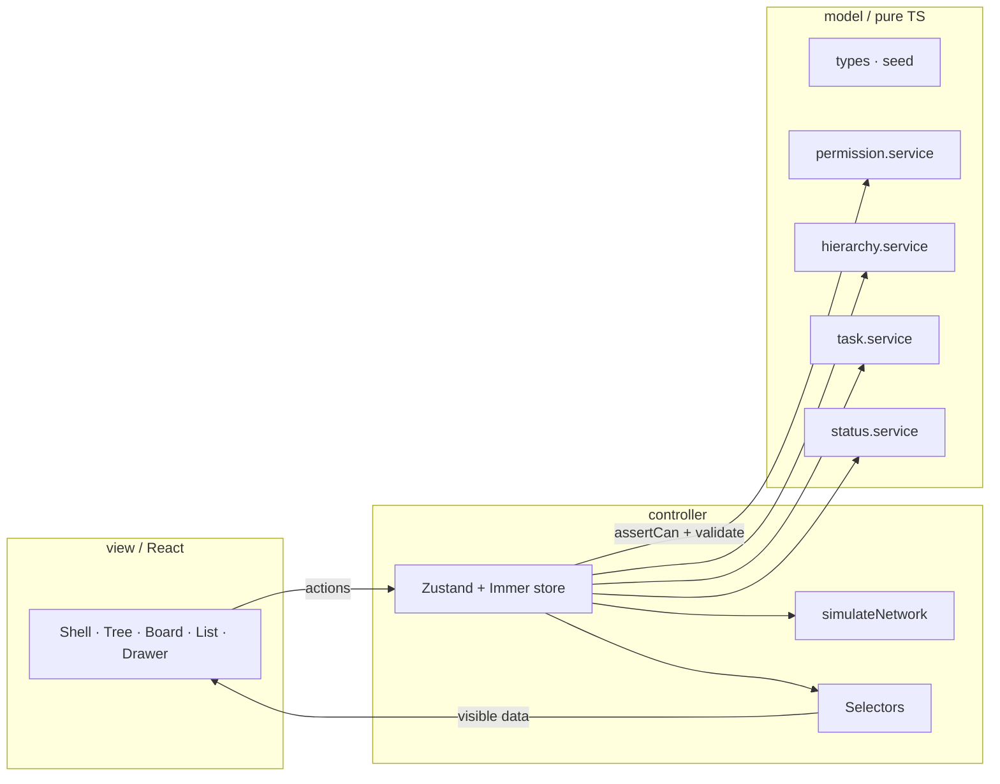

# Flowboard

I built Flowboard as a frontend take-home: a small ClickUp-style board with hierarchy, permissions, and optimistic edits, all in the browser.

Live demo: https://flow-board-one-pied.vercel.app/  
Demo video: to be added

---

## Run locally

```bash
npm install
npm run dev
```

| Command | What it does |
| --- | --- |
| `npm run typecheck` | TypeScript project check |
| `npm run lint` | ESLint |
| `npm run test` | Vitest unit and component tests |
| `npm run build` | Typecheck + production build |
| `npm run test:e2e` | Playwright permission-flow E2E |

Playwright needs Chromium once: `npx playwright install chromium`.

---

## Try it in two minutes

1. Open the app as **Alice** (admin). Expand Engineering → Platform and select **Backlog**.
2. Switch to **Bob**. **Sprint** and the private **Leadership** space (including OKRs) disappear from the tree. Backlog stays.
3. Switch to **Carol**. Open **Backlog** — she has a read-only grant there, so the drawer shows a read-only banner and edits stay disabled. She can still open Sprint and Leadership.
4. As Alice, drag a card between columns on the board. Status and order update.
5. Open **Dev** → **Fail next mutation**, then drag a card again. The move rolls back and you get an error toast with Retry.
6. Type in the view-bar search to filter cards by title or description.
7. Open a task and scroll the drawer activity feed.

Seed matrix and users: `src/model/seed.ts`.

---

## What is built

- **Hierarchy** — workspace → space → folder → list (`src/model/`, `src/view/tree/`)
- **Tasks** — CRUD, duplicate, archive/restore via `task.service` and the store
- **Statuses** — per-list sets; category remap on cross-list move (`status.service`)
- **Kanban / list** — board DnD in `src/view/board/`; sort + Load more in `src/view/list/`
- **Sidebar** — permission-filtered tree, collapse, archived restore
- **Permissions** — Alice / Bob / Carol; `permission.service` + store `assertCan`
- **Data layer** — in-memory seed; Dev menu → Fail next (`simulateNetwork`)
- **UX / tests** — skeletons, empty states, toasts; Vitest + one Playwright E2E

---

## Architecture



`model/` is pure TypeScript (`Result<T>`, no React). `controller/` is the only writer (Zustand). `view/` uses selectors and store actions only.

**Mutation pipeline:** `assertCan` → service validation → `simulateNetwork` (Fail next) → apply → toast / activity. Status moves apply optimistically and roll back on failure.

---

## Data model

Normalised `AppState` in `src/model/types.ts`. Seed: `src/model/seed.ts`.

| Entity | Key fields |
| --- | --- |
| **ContainerNode** | `id`, `kind` (`workspace` \| `space` \| `folder` \| `list`), `name`, `parentId`, `position`, `archivedAt`, `isPrivate` |
| **Status** | `id`, `listId`, `name`, `category` (`todo` \| `active` \| `done`), `color` (hex), `position` |
| **Task** | `id`, `listId`, `title`, `description`, `statusId`, `priority`, `assigneeIds`, `dueDate` (`YYYY-MM-DD` \| null), `position`, `parentTaskId`, `archivedAt`, `activity[]` |
| **User** | `id`, `name`, `email`, `role` (`admin` \| `member`), `color`, `avatarUrl` |
| **Grant** | `id`, `userId`, `nodeId`, `effect` (`allow` \| `view` \| `deny`) |

| Brief | This repo | Why |
| --- | --- | --- |
| Node `type` | `kind` | Avoids clashing with TypeScript `type` |
| Task `primaryListId` | `listId` | One list per task here |
| Grant `resourceId` / `mode` | `nodeId` / `effect` | Clearer names; `view` for read-only |
| Status `in_progress` | `active` | Shorter token; UI still says “In Progress” |
| `dueDate` as datetime | `YYYY-MM-DD` | Calendar-day display without timezone noise |

---

## How permissions work

Admins bypass checks. For members, the nearest grant on the node or an ancestor wins: `allow` (view + edit), `view` (read-only), `deny` (hidden). With no grant, any private ancestor hides the node; otherwise it is visible.

Rules: `src/model/services/permission.service.ts`. The store calls `assertCan` before mutations (`FORBIDDEN` on failure). Selectors hide what the user cannot see. Forbidden actions get an amber lock toast; the drawer shows a read-only banner when `selectCanEditTask` is false.

I would extend this with team grants, per-task grants, an inheritance override, and more roles — still through the same service + store pipeline.

---

## Decisions

- **Archive** is soft delete (`archivedAt`) with cascade and restore. Tasks can also be hard-deleted after confirm.
- **No domain persistence** — reload returns to seed. Only `flowboard.theme` is in `localStorage`.
- **List pagination** is offset-based (page size 10 + Load more).
- **Extra libraries:** dnd-kit for drag; Radix via shadcn for dialogs/menus; `react-day-picker` for due dates; `cmdk` for the shadcn Command primitive in `src/view/ui/command.tsx`.

---

## Styling

Tailwind utilities in JSX only. The only inline `style=` usages are dnd-kit transforms in `SortableTaskCard.tsx` and `SortableTreeRow.tsx` (`DND-STYLE-EXCEPTION`).

---

## Stretch goals

I am claiming two stretch items: **optimistic UI with rollback** (Dev menu → Fail next mutation) and **client-side search**.

Smaller extras I also built: drawer activity feed, keyboard shortcuts, tree drag reorder, admin grants dialog, and dark mode (brief calls dark mode out of scope). That is more than the suggested two; required features and tests came first.

---

## Trade-offs and next steps

**Left out on purpose (not required by the brief):**
- A screen for managing statuses. The service and tests exist; new lists start with To do / In progress / Done.
- Saving data across reloads. The brief says persistence is optional, so a reload returns to the seed data.

**Known limitation:** when an optimistic move fails, I restore the whole saved state, not just that task.
Two quick drags that overlap could undo each other. Fixing this means rolling back only the affected task.

**What I would do next:**
- Replace the in-memory store with a real API and persistence.
- Team-based grants.
- Rollback per mutation, so overlapping drags are safe.
- End-to-end tests for drag and drop.
- A status editor in the UI.

---

## Tests

Permissions and hierarchy services, task rules (status remap), store rollback and activity, search, list sort/pagination, a few components, and one Playwright flow (Alice → Bob hides Leadership, then a status-change toast).

```bash
npm run test
npm run test:e2e
```

---

## AI usage

I used Cursor for scaffolding, UI primitives, and tests. I reviewed diffs, corrected mismatches, and kept business rules in model/controller. Details: [`AI_USAGE.md`](./AI_USAGE.md). Plan notes: [`plan/`](plan/).
